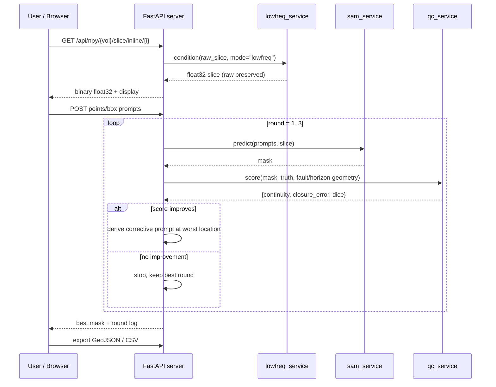

# Design Document — SamForGeophysics MVP

## Overview

Keep the inherited SGSeg request/response path intact and add three thin services on top:

| Layer | Existing | New |
|---|---|---|
| Data | `npy_service.py`, `sgy_service.py` | `scripts/generate_synthetic_seismic.py` (deterministic synthetic volumes + truth masks) |
| Conditioning | `canvas.js` display modes | `src/lowfreq_service.py` (spectral weighting, read-only on stored volume) |
| Interpretation | `sam_service.py`, `validation_service.py` | `src/qc_service.py` + a prompt-refinement driver |
| Presentation | `index.html`, `src/static/js/*` | round-by-round QC panel, low-frequency toggle, demo-friendly defaults |

No new framework, no build step. SAM weights remain external.

## Data flow

## Synthetic volume construction

`scripts/generate_synthetic_seismic.py` builds a reflectivity series per trace:

- `nIL × nXL × nSamples` float32 volume; time axis from `dt_us` (default 2000 us).
- Four gently undulating horizons; each is a Ricker wavelet `(1 - 2a)·exp(-a)`, `a = (π f t)²`, at a shallow dominant frequency.
- A fault plane at a slowly varying crossline position offsets deeper horizons by a fixed throw.
- A weak elliptical **deep target** rendered with a lower dominant frequency and a deliberately small amplitude — the element that low-frequency conditioning is meant to reveal.
- Additive Gaussian noise at a declared SNR. A `--clean` variant with a high SNR represents the "cleaner platform" idea in software.
- Ground-truth boolean masks for fault, horizons and deep target, written under `truth/`.

Same seed → identical bytes (`np.random.default_rng(seed)`, `--verify-only` re-generates and compares).

## Low-frequency conditioning

`lowfreq_service.py` operates on a 2-D float32 slice:

1. `np.fft.rfft` along the time axis.
2. Multiply by a documented cosine-tapered weight that preserves the low band and attenuates the high band.
3. `np.fft.irfft` back, cast to float32, normalise by a declared constant.

The raw slice is never overwritten; the UI keeps both. All constants live at module top with comments. This is an **image-conditioning heuristic**, not a physical inversion — documentation must say so.

## QC metrics

> **Superseded 2026-11-12** (`.kiro/steering/scope.md` D2): the loop is driven by label-free deep-target QC (edge leakage, envelope contrast) plus fault continuity; truth overlap is reported only; horizon closure error is deferred. The new design lives in `.kiro/specs/qc-refine-loop/`. The text below is kept for history.

`qc_service.py` consumes a mask and the truth masks:

- **fault continuity**: fraction of adjacent crossline columns whose detected fault sample index differs by at most `CONTINUITY_TOL_SAMPLES`; penalise gaps.
- **horizon closure error**: sample-index mismatch after tracing a closed inline/crossline loop; report in samples and in ms using `dt_us`.
- **overlap**: delegate to `src/validation_service.py` (IoU / Dice / Precision / Recall).

Thresholds are declared constants. Do not tune on the demo volume and then present the tuned score as a general benchmark.

## Prompt refinement driver

- Round 1 uses the user's prompts.
- After each round, locate the worst-scoring spatial region (largest discontinuity / largest closure mismatch) and add a corrective point (positive if the mask under-covers, negative if it over-covers) or a tightened box.
- Keep the best round by a declared composite score; stop after 3 rounds or when the composite does not improve.
- Append `{round, prompts, metrics, delta}` to a log the UI renders. This log is the visible innovation in the demo.

## Error handling

- Missing weights → explicit message; browsing, conditioning and QC remain available.
- Missing NumPy / wrong dtype / non-finite values in the generator → fail early with a clear message.
- LLM assist is optional; no API key must be required for any core path.

## Testing strategy

- `python scripts/generate_synthetic_seismic.py --verify-only` (determinism + shape + dtype + meta consistency).
- `python scripts/preflight.py --check all` (`.kiro` visibility, forbidden claims, data provenance).
- `pytest tests/` for inherited core behaviour; add focused tests for lowfreq shape preservation and QC monotonicity on trivially constructed masks.
- Manual: full 3-minute scripted flow before recording.

## Risks / open items

- SAM weights are large and cannot be committed; the demo must be robust to a no-weight environment.
- Prior-work citations and the competition dates were verified on 2026-11-08; see `.kiro/steering/sources.md` and `docs/COMPETITION_RULES.md`.
- QC thresholds are heuristic; present them as such, never as validated geophysical accuracy.
