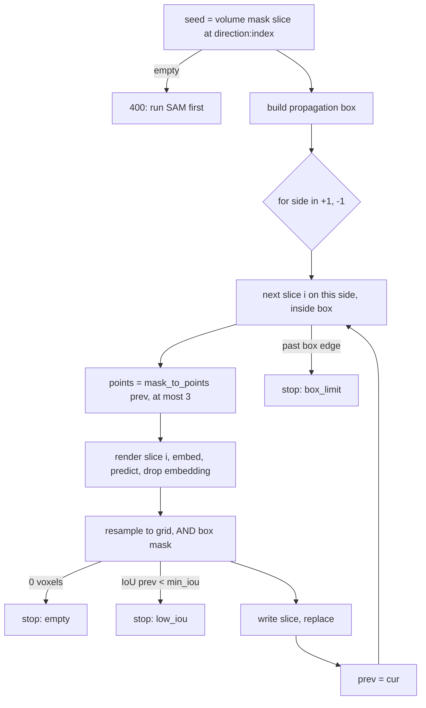

# Design Document — Volume Mask and Cross-Slice Propagation

## Overview

Two thin services, imported by `server.py`, on top of the existing SAM path:

| Module | Responsibility |
|---|---|
| `src/volume_mask_service.py` | Map a 2-D mask onto the volume grid; store, read back and describe voxel masks. No SAM dependency. |
| `src/propagation_service.py` | Render slices, derive point prompts from the previous mask, call `sam_service`, clip to the propagation box, write through `volume_mask_service`. |
| `src/sam_service.py` (changed) | Encoder-feature cache so each image is encoded once; `predict_mask_np` and `drop_embedding` for in-process callers. |

No new framework. One new dependency: `scipy` (connected components and distance transform in `ndimage`).

## Data contract

```
data/npy/<vol>/amplitude.npy            float32 [nIL, nXL, nSamples]   (read-only here)
data/npy/<vol>/masks/<name>.npy         bool    [nIL, nXL, nSamples]   (np.lib.format memmap, updated in place)
data/npy/<vol>/masks/<name>.json        provenance: per-slice records keyed "direction:index", voxel_count
```

`<name>` matches `^[A-Za-z0-9_.-]{1,64}$` and is not `.` or `..`. `data/` is gitignored, so masks never reach the repository.

Slice orientation matches `npy_service` and the binary slice endpoints:

| Direction | Slice image (rows, cols) | Volume view |
|---|---|---|
| inline `i` | `(nSamples, nXL)` | `vol[i].T` |
| crossline `j` | `(nSamples, nIL)` | `vol[:, j, :].T` |
| timeslice `k` | `(nIL, nXL)` | `vol[:, :, k]` |

`_slice_view` returns a writable view in slice-image orientation, so reading and writing use the same code path.

## Mapping a SAM mask to the grid

SAM returns a mask in display-image pixels: the slice was upscaled (by the frontend or by `render_slice_image`) and may have been downscaled again to a 1024 px long side. The mask always covers the whole slice image, so a plain resize to the native grid is enough:

1. Cast to float32; reject empty, non-2-D or non-finite input.
2. If the shape already equals the grid, threshold directly. Otherwise resize with PIL bilinear in mode `F` to `(cols, rows)`, then threshold at 0.5.

Resizing the float mask first and thresholding afterwards keeps thin boundaries that nearest-neighbour downsampling would drop.

## Propagation algorithm



**Propagation box** (closed intervals, clipped to the volume):

| Seed direction | IL range | XL range | Sample range |
|---|---|---|---|
| inline `i` | `i ± max_il` | seed cols `± max_xl` | seed rows `± max_vertical` |
| crossline `j` | seed cols `± max_il` | `j ± max_xl` | seed rows `± max_vertical` |
| timeslice `k` | seed rows `± max_il` | seed cols `± max_xl` | `k ± max_vertical` |

The half-width on the propagation axis is a step limit; on the other two axes it limits how far the mask may grow beyond the seed's bounding box.

**Point prompts** (`mask_to_points`): label the previous mask, keep the largest connected component, take the distance-transform peak as the first point, then greedily add the candidate farthest from the chosen points among pixels with distance ≥ half the peak, up to 3 points and at least 2 px apart. Every point lies inside the mask, so a thin or ragged edge cannot pull the prompt off the target.

**Rendering**: the slice is clipped to its 2–98 percentile range, scaled to uint8 and upscaled by an integer factor `round(1024 / long_side)`. Point coordinates are pixel centres: `x = (col + 0.5)·f`, `y = (row + 0.5)·f`.

**Stopping**: each side keeps its own `prev` and stops at the first failing slice. The failing slice is reported but not written, so a drift never contaminates the volume mask.

## SAM call path and latency

`sam_service.embed_image` runs the encoder once through Ultralytics `Predictor.set_image`, wrapped in `torch.inference_mode()`, and stores the resulting features in an LRU cache (8 entries). `set_image` itself does not disable autograd, and without the wrapper each cached feature set kept the encoder's autograd graph (~35 GB of VRAM measured on one embed). `_run_prompted` puts the cached features on the predictor, runs the prompt decoder only, and resets the predictor afterwards. A process-wide `RLock` serialises all encoder and decoder calls, because the Ultralytics predictor holds per-image state.

Propagation embeds a temporary PNG per slice and drops the embedding right after its single prediction. When the cache is already full, each of those embeds still evicts the oldest cached entry, so a long propagation can push out the interactive user's features. Evicted features are re-encoded on the next predict for that embedding (one extra encoder pass, ~0.3 s on the reference GPU), so this costs a little time but does not change results.

## HTTP API (`src/server.py`)

| Method and path | Body / result | Errors |
|---|---|---|
| `POST /api/npy/{vol}/mask` | `{direction, index, mask, mask_name="sam_mask", threshold=0.5, mode="replace", score?, points[]}` → slice and total voxel counts | 400 invalid input, 404 unknown volume |
| `POST /api/npy/{vol}/propagate` | `{direction, index, mask_name, max_il=5, max_xl=5, max_vertical=30, min_iou=0.1}` → box, limits, per-slice records, `written_indices`, `total_voxels` | 400 empty seed / bad limits, 404 unknown mask or volume, 500 SAM error |
| `GET /api/npy/{vol}/masks` | `{masks: [{mask_name, voxel_count, slices_written}]}` | 404 unknown volume |
| `GET /api/npy/{vol}/mask/{name}/info` | provenance + `bbox_index`, `bbox_coords`, `centroid_coords` | 400 bad name, 404 not found |
| `GET /api/npy/{vol}/mask/{name}/slice/{direction}/{index}` | binary float32 0/1, `X-Rows` / `X-Cols` | 400 bad direction or index, 404 not found |

`propagate` is a sync route, so FastAPI runs it in the thread pool and the event loop stays responsive during the GPU loop.

## Frontend (`src/static/js/sam-client.js`, `sgy-client.js`, `index.html`)

- After `▶ SAM` succeeds on an NPY volume, the client posts the mask to `/mask` under the fixed name `sam_mask` and appends the voxel and slice counts to the status text.
- On every slice load, `loadVolumeMaskOverlay` fetches the mask slice and, if any voxel is set, draws it through the same overlay buffer as a live SAM result. A response for a slice the user has already left is discarded.
- `🔁` runs propagation for the current slice; `⚙` opens the limits panel. Slider maxima follow the loaded volume's axis lengths.

## Error handling

- Validation happens before the memmap is opened, so a rejected write leaves the stored mask untouched.
- An existing mask file whose shape or dtype does not match the volume is refused, not silently reshaped.
- Missing weights currently surface from `/propagate` as HTTP 500 with the loader's message; Requirement 4.5 asks for an explicit 503 (open task).

## Testing strategy

| Level | What | Where |
|---|---|---|
| Unit, no GPU | Round-trip of upscaled / downscaled masks in all three directions, replace vs union, 3-D info coordinates, validation errors | `tests/test_volume_mask.py` |
| Unit, no GPU (SAM stubbed) | Point placement, box construction per direction, 2-D box orientation, default ±5 limit, zero range, stop on empty / low IoU, bad arguments | `tests/test_propagation.py` |
| Unit, no GPU (model stubbed) | Encoder runs under inference mode; feature cache and release | `tests/test_sam_service.py` |
| End-to-end, GPU + weights | SAM → volume mask → read-back; seed click → propagate with default and tightened limits, box containment, error codes | `scripts/test_sam_inference.py`, `scripts/test_propagation_e2e.py` (server must be running; delete the `sam_*_test` masks afterwards) |

The unit tests stub SAM, so they cannot catch failures that only real model output produces. That is how the empty-mask regression in the first implementation went unnoticed; the GPU scripts are the check for that class of bug.

## Known limitations

- Prompts are positive points only; there is no negative prompt for leakage into neighbouring reflectors.
- Propagation runs on raw amplitude. Once low-frequency slices are served (MVP Wave 2), propagation should accept the same `mode`.
- Mask writes are not locked per mask. Two concurrent writers to one mask (for example a propagate call and a manual SAM write) can lose a provenance record.
- The UI always uses the mask name `sam_mask`; there is no UI to clear or switch masks.
- Comments and error strings in both services are Chinese; the submission UI and docs must be English.
