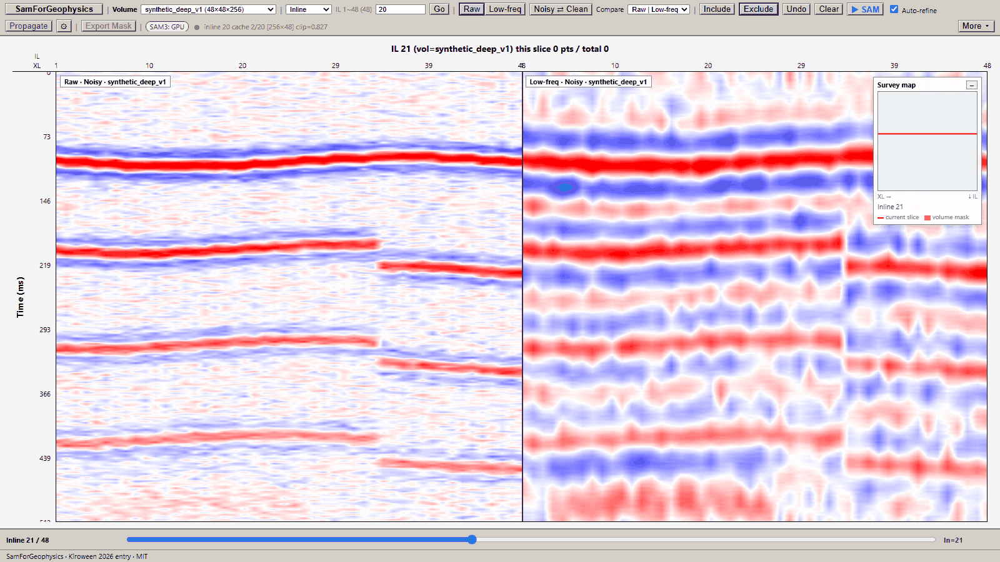
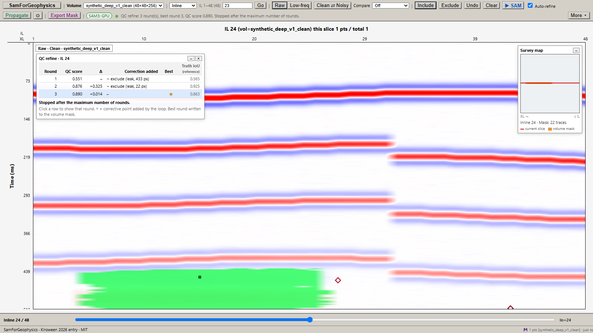
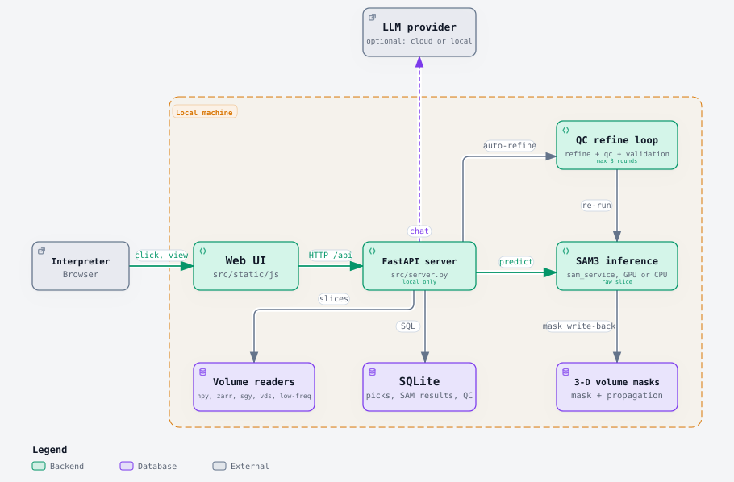

# SamForGeophysics

Interpret a weak deep seismic target with SAM3, a low-frequency view and a QC loop that checks its own masks.

Meta's SAM3, a vision model trained on natural images, stitched into a seismic interpretation workstation together with signal processing and a label-free quality check.

## What it does

A geophysicist opens a synthetic seismic section with a faint deep target and:

1. **Sees it better.** One click switches the section between the raw amplitudes and a low-frequency view, or shows both side by side. A second click jumps to the same slice of a cleaner (low-noise) recording of the same model, the *noisy / clean pair*.
2. **Prompts SAM3.** Click once on the target and press **▶ SAM**. The server renders the slice, SAM3 segments it, and the mask is written back into a 3-D volume mask; a small survey map shows its footprint.
3. **Lets the loop check the mask.** With **Auto-refine** on, a label-free QC scores the mask (how much of it leaks outside the clicked reflection's energy, how much of that energy it misses), adds one corrective include or exclude point at the worst region, and runs SAM again, for at most 3 rounds. It keeps the round with the best QC score and shows every round in a panel. Where the target is too weak for that check, it says so and stops.
4. **Exports** the result as GeoJSON and CSV polygons plus a JSON log of the QC rounds.

All data is synthetic and generated by a script with a fixed seed. Nothing here has been tested on field data.

### The workspace at a glance


*Compare mode on the noisy volume: raw amplitudes (left) and the low-frequency view (right) on inline 21, where the deep reflection becomes visible at the lower left.*


*The QC panel on clean inline 24: three refinement rounds with corrective points (hollow diamond on the section), QC scores, deltas, and the best round marked with ★.*

## Results on the synthetic model

Every number below is printed by a script and recorded with its conditions in [`docs/MEASUREMENTS.md`](docs/MEASUREMENTS.md).

| Question | Result | Script |
|---|---|---|
| Does the low-frequency view separate the deep target from the background? | Noisy volume: AUC 0.44 (raw) → 0.93 (low-freq). The model was built with a 10 Hz target, so this confirms the pipeline, not real-data separability | `scripts/measure_lowfreq.py` |
| Which view should SAM3 segment? | The raw one. One click on the noisy volume: mean IoU 0.43 on raw vs 0.06 on low-freq. So the low-frequency view is for the interpreter's eyes; SAM3 and the QC always work on the raw slice | `scripts/measure_refine.py` |
| Does the QC loop improve a one-click SAM3 mask? | Clean volume, raw view, 19 inlines (one simulated include click placed at the interior point of the ground-truth target slice, the pixel farthest from its edge): mean IoU 0.80 → 0.81 (median 0.88 → 0.89); better on 9 slices, worse on 3, unchanged on 7. On the noisy volume the loop declined to run on 18 of 19 slices because the target is too weak for the check | `scripts/measure_refine.py` |

IoU is measured against the generator's ground-truth mask, which the loop never sees. The loop is not guaranteed to improve a mask: on 3 of the 19 clean slices it kept a round that scored better on QC but worse against the truth.

## Run it

The app is a local web app: a Python server plus a page in your browser. There is no hosted instance.

**Platform:** Windows 10/11 or Linux desktop, a current desktop browser (tested with Chrome only). An NVIDIA GPU is recommended; on CPU, each new slice takes about 15 s to encode for SAM3.

**Prerequisites**

- **Python 3.10, 3.11 or 3.12** (tested: 3.12). Python 3.14 fails because `numpy<2.0` has no wheels for it; 3.13 is untested.
- Git.
- Node.js is optional; it only provides the `npm run …` shortcuts. Every step has a plain Python command.
- Disk space: 3.5 GB for the SAM3 weights plus a few GB for PyTorch.

**1. Get the code and create a virtual environment**

Windows (PowerShell):

```powershell
git clone -b kiro https://github.com/luziqing/seismic-exploration-system.git SamForGeophysics
cd SamForGeophysics
py -3.12 -m venv .venv            # or, if Python 3.12 came from uv: uv venv --seed --python 3.12 .venv
.venv\Scripts\Activate.ps1
```

Linux:

```bash
git clone -b kiro https://github.com/luziqing/seismic-exploration-system.git SamForGeophysics
cd SamForGeophysics
python3.12 -m venv .venv && source .venv/bin/activate
```

**2. Install dependencies**

```bash
# With an NVIDIA GPU, install the CUDA builds of PyTorch and torchvision first
# (PyPI's default torch on Windows is CPU-only, and a torchvision from PyPI would replace the CUDA torch):
python -m pip install torch torchvision --index-url https://download.pytorch.org/whl/cu124
# Then the app (and the test tools):
python -m pip install -r requirements.txt -r requirements-dev.txt
# Check: should print True for CUDA
python -c "import torch; print(torch.__version__, torch.cuda.is_available())"
```

Tested on a fresh Windows 10 machine with an RTX 4090 ([log](docs/kiro/build-log.md#e2-clean-clone-on-a-second-machine)). For other CUDA versions, pick the matching index on <https://pytorch.org/get-started/locally/>.

**3. Generate the demo data** (deterministic, 48 × 48 × 256 samples, about 2.4 MB each, written to `data/npy/`)

```bash
python scripts/generate_synthetic_seismic.py           # noisy volume (6 dB SNR)
python scripts/generate_synthetic_seismic.py --clean   # clean volume (30 dB SNR)
```

**4. Get the SAM3 weights** (optional; without them see [No-weights mode](#no-weights-mode))

The weights are not in this repository. They are Meta's, under the [SAM License](https://github.com/facebookresearch/sam3), published on the gated Hugging Face repository [`facebook/sam3`](https://huggingface.co/facebook/sam3) (code: [facebookresearch/sam3](https://github.com/facebookresearch/sam3)).

1. Request access on <https://huggingface.co/facebook/sam3>. Approval is Meta's decision and can take a while, so do this first.
2. Download `sam3.pt` into `data/weights/`:
   ```bash
   python -m pip install -U huggingface_hub
   hf auth login
   hf download facebook/sam3 sam3.pt --local-dir data/weights
   ```
3. Check the file: 3,450,062,241 bytes, SHA-256 `9999e2341ceef5e136daa386eecb55cb414446a00ac2b55eb2dfd2f7c3cf8c9e`.
   ```powershell
   (Get-FileHash data\weights\sam3.pt -Algorithm SHA256).Hash -eq '9999e2341ceef5e136daa386eecb55cb414446a00ac2b55eb2dfd2f7c3cf8c9e'   # Windows: True
   ```
   ```bash
   sha256sum data/weights/sam3.pt                          # Linux
   ```

**5. Start**

```bash
python src/server.py
```

Open <http://127.0.0.1:9339>. The first SAM run also loads the model, so it takes longer than the next ones. The server listens on all network interfaces by default; set `SAM3_HOST=127.0.0.1` to keep it local, `SAM3_PORT` to change the port.

**6. Check the build** (no GPU or weights needed)

```bash
python scripts/verify.py        # or: npm run verify
```

It checks JavaScript and Python syntax, runs the project's preflight checks and the test suite, and confirms that the demo data is byte-identical to the generator's output. It prints `VERIFY OK` when everything passes.

### No-weights mode

Without `data/weights/sam3.pt` the app still opens. Browsing, the low-frequency view, the noisy / clean pair, the compare view, the survey map and export work. The toolbar badge reads **SAM3: weights missing** and its tooltip says where to get them; ▶ SAM and propagation answer with the same message instead of failing silently.

## Testing instructions (what to click)

1. Open <http://127.0.0.1:9339>. The noisy volume `synthetic_deep_v1` loads on its middle inline (IL 25). Type `20` in the box next to the direction menu and press **Go** (the box counts from 0; the title then reads IL 21): the deep target is the faint body near the bottom of the section (about 430–510 ms), left of the fault.
2. Press **Low-freq**, then choose **Compare → Raw | Low-freq** to see both. Press **Noisy ⇄ Clean** to jump to the same inline of the clean volume. Set Compare back to **Off** and press **Raw**.
3. On the clean volume, IL 24 (box value `23`): press **Include**, click once in the middle of the deep target, and press **▶ SAM** (Auto-refine is on). The QC panel lists the rounds; click a row to see that round's mask, with the loop's corrective points as hollow diamonds. The survey map shows the mask footprint.
4. Do the same on the noisy volume: the gate stops the loop on most slices of the noisy volume (18 of 19 in the measurement); the panel explains that the target is too weak for the QC on that slice and keeps SAM's mask.
5. Press **Export Mask**: you get `…geojson`, `…csv` and `qc_log_….json`.
6. Optional: **Propagate** extends the mask to neighbouring inlines (settings under ⚙).

Other controls (SEG-Y / VDS loading, playback, gain, AI assistant) are under **More ▾**; they come from the earlier SGSeg project and are not part of this project.

## How it works



*Runtime architecture, generated with [Archify](https://github.com/tt-a1i/archify) from [`docs/architecture/runtime-architecture.json`](docs/architecture/runtime-architecture.json). The interactive version is `docs/architecture/runtime-architecture.html`.*

| Part | File |
|---|---|
| Synthetic model: four horizons, a fault, a weak 10 Hz deep target; noisy and clean variants; ground-truth masks | `scripts/generate_synthetic_seismic.py` |
| Low-frequency view (spectral weighting along time, raw slice kept) | `src/lowfreq_service.py`, `GET /api/npy/{vol}/slice/{dir}/{i}?mode=lowfreq` |
| Server-side rendering of the slice for SAM3, so the embedding never contains pick markers | `POST /api/npy/{vol}/embed` |
| Label-free QC: reference = envelope around the user's click; leak, miss and a reliability gate | `src/qc_service.py` |
| Refine loop: up to 3 rounds, one corrective point per round, best round kept, rounds logged in SQLite | `src/refine_service.py`, `POST /api/npy/{vol}/refine`, `GET /api/refine/{run_id}` |
| Volume mask and cross-slice propagation | `src/volume_mask_service.py`, `src/propagation_service.py` |
| UI: compare view, survey map, QC panel | `src/static/js/compare.js`, `src/static/js/survey-map.js`, `src/static/js/refine-panel.js` |

Design decisions and their reasons, including the ones that failed, are in `.kiro/specs/qc-refine-loop/` (requirements → design → tasks with dated findings).

## How the engineering is organised

The software is built the way an experiment is run: the question and the test are written down before the answer is known, and the result decides what ships. The repository keeps the whole record, failures included.

1. **Question before code.** Each feature starts as a spec in `.kiro/specs/` with acceptance criteria written before any result is seen: requirements, then design, then tasks. The QC loop's spec was written first; when the first QC design failed its own criterion on the demo data (the ground truth ranked best in 0 of 12 checks, and a property-based test found that adding background could raise the score), the design was changed in the spec first and then in the code. The failure and the redesign stay in `.kiro/specs/qc-refine-loop/tasks.md`.
2. **Measurement as the arbiter.** A result comes from a script with its protocol declared at the top before the first run: fixed data, a fixed click rule, a fixed metric, run once, reruns byte-identical. Its output, not preference, set the product defaults: SAM3 segments the raw slice because the low-frequency view measured worse for it, although the low-frequency view helps a human see the target. Every public number points to `docs/MEASUREMENTS.md`, together with what it does *not* show.
3. **An explicit boundary.** `.kiro/steering/scope.md` lists what is built, the check that proves each item done, and rules for converging: no redesign after a fixed date, one measurement run, the story follows the numbers. Anything outside it waits.
4. **Rules that execute.** Constraints are code, not prose: steering files give every agent session the same rules; hooks run the matching tests when a module is saved, block commits of data or weights, and check public text for unsourced claims; `scripts/verify.py` proves the build in one command; a read-only reviewer agent audits the README and other public text against the measurements.
5. **People decide, agents build, other agents check.** The owner made the decisions that change meaning (which QC design, which view the QC reads, what is in scope), each from a written list of options with their trade-offs. Agent sessions implemented and tested. Verification was handed to agents with a fresh context, for example a clean install on a second machine by a session that had never seen the repository, following only this README.

**Where this leads.** The same organisation is meant to carry the work past synthetic data. Moving to field data does not change the method: declare the metric and the protocol, run once, report what failed. The label-free QC carries a pattern worth keeping in geophysical software: a model output that comes with its own check, and that declines to act when the check is not reliable (here, the noisy volume). Faults and horizons are the next targets for that pattern, and the spec, measurement and audit trail in this repository is how a reader can see whether it worked.

## Why this was entered in Kiroween

The hackathon was a test of a question the author has as a researcher: can an agent-driven, spec-first workflow build research software that stays honest about its evidence, within five weeks, with one person making the decisions? The hope is feedback from both sides, geophysicists on whether the workflow is useful and developers on whether the engineering method holds up. How Kiro's tools were used is documented separately in [`docs/kiro/KIRO_USAGE.md`](docs/kiro/KIRO_USAGE.md).

## What is new, and what came before

This repository started on 2026-11-09 (first commit, `git log`). Part of it comes from **SGSeg**, the author's earlier seismic segmentation tool (begun in June 2026, part of the author's PhD work, solely the author's):

- **From SGSeg:** the slice viewer and its SEG-Y / Zarr / VDS / NumPy loaders, the basic SAM3 embed-and-predict calls and point picking, the first GeoJSON / CSV export, IoU / Dice validation, the LLM assistant, SQLite sessions and local backup.
- **Built in this repository (from 2026-11-09):** the synthetic model and its ground truth; the low-frequency view and the noisy / clean comparison; the measurement scripts; server-side SAM3 rendering; the volume mask, propagation and survey map; the label-free QC, the refine loop, its API, log and panel; the rewritten export with the QC log; the no-weights mode; the English UI; and the whole `/.kiro` workflow.

Prior work on SAM for seismic exists and this project does not claim to be the first: *Seismic Fault SAM* ([arXiv:2407.14121](https://arxiv.org/abs/2407.14121)) and *Domain-Guided Prompting of SAM for Seismic Interpretation* ([arXiv:2606.15786](https://arxiv.org/abs/2606.15786)), which also conditions SAM's input with seismic attributes. What this project adds is the label-free QC loop that decides for itself when it can be trusted, and the noisy / clean pair.

## Licence and data

Code: MIT ([LICENSE](LICENSE)). SAM3 weights: Meta's SAM License, not redistributed here. Demo data: fully synthetic, see [`docs/DATA_PROVENANCE.md`](docs/DATA_PROVENANCE.md). "Cleaner platform" means lower-noise data; no UAV or quantum sensor is implemented.
